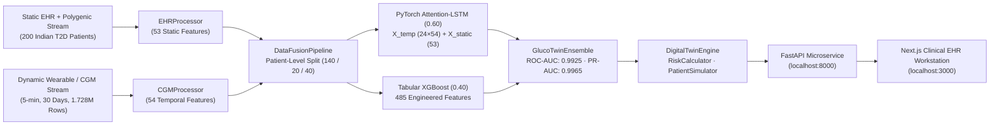

# 🩺 GlucoTwin — Multimodal Clinical Digital Twin for Type 2 Diabetes

> **Digital Twin Challenge 2026 · Happiest Health · Reimagining & Reforming Healthcare in India Summit**

---

## 👥 Team Details & College / Incubator Information

| Field | Details |
|---|---|
| **Team Name** | Aethan |
| **College / Institution** | Amity University Mumbai |
| **Team Leader** | Anurag Roopchandra Kannojiya (`anuragkannaujiyak@gmail.com`) |
| **Public GitHub Repository** | [https://github.com/AnuragKannojiya/Aethan_AmityUniversityMumbai](https://github.com/AnuragKannojiya/Aethan_AmityUniversityMumbai) |
| **Submission Folder** | `Aethan_AmityUniversityMumbai` |

---

## 📌 Project Title

**GlucoTwin: A Multimodal Clinical Digital Twin for 2-Hour Ahead Glucose Spike Prediction and Counterfactual Intervention Simulation in Indian Type 2 Diabetes Patients**

---

## 🏥 Problem Statement & Healthcare Use Case

India has **over 101 million adults living with Type 2 Diabetes** (ICMR-INDIAB 2023). South Asian patients exhibit the **Asian-Indian Phenotype**—marked by higher visceral adiposity, elevated triglycerides with low HDL, earlier beta-cell exhaustion at lower BMIs, and high prevalence of polygenic risk variants such as *TCF7L2* (`rs7903146`) and *PPARG* (`rs1801282`). Standard outpatient care is **reactive**: quarterly HbA1c checks only reflect a 90-day average and miss acute **postprandial glucose spikes (`>180 mg/dL`)** that cause microvascular and cardiovascular damage.

**GlucoTwin** creates a dynamic virtual replica of each patient by fusing two streams:

1. **Static / Historical EHR Stream (53 Features):** Simulated Electronic Health Records (`data/raw/ehr_patients.csv`) for 200 Indian T2D patients, capturing demographics, BMI, diabetes duration, lab results (HbA1c, fasting glucose, LDL, HDL, triglycerides, eGFR, creatinine, blood pressure), active oral/insulin regimens, multi-label comorbidities, dietary pattern, and **polygenic risk markers** (*TCF7L2* `rs7903146`, *PPARG* `rs1801282`, and composite `genetic_risk_score`).
2. **Dynamic / Real-Time Wearable & IoT Stream (54 Features):** Simulated 5-minute continuous time-series data across 30 days (`data/raw/cgm_readings.csv`, 1,728,000 rows) capturing **Continuous Glucose Monitoring (CGM)**, **Heart Rate Variability (`hrv_rmssd` in ms)**, **Heart Rate (`bpm`)**, **Sleep Stages (`awake`, `light`, `deep`, `rem`)**, **Step Count (`steps/5m`)**, skin temperature, and autonomic stress index.

### Clinical Use Case
A diabetologist opens the **GlucoTwin Clinical EHR Workstation**:
1. The **Cohort Priority Triage Queue** automatically ranks all 200 patients by their composite 2-hour risk score (`Critical`, `High`, `Moderate`, `Low`).
2. Selecting a high-risk patient displays their static EHR labs and polygenic risk profile alongside a **Synchronized Dual-Stream Chart** (6-hour historical CGM + 2-hour ahead trajectory on top; wearable HRV, Heart Rate, and Steps below).
3. The **Multimodal Feature Attribution** panel explains *why* the patient has a high spike probability across both `Wearable (Dynamic)` and `EHR (Static)` streams, alongside the **24-step LSTM Temporal Self-Attention** footprint.
4. Using the **Interactive Counterfactual Simulator**, the clinician tests a **20-minute post-meal brisk walk** and **scheduled medication dose**, observing in real time how the simulated trajectory stays within the `70–180 mg/dL` target range before issuing the recommendation.

---

## 🏗️ System Architecture



- **Architecture Diagram (PDF, PPTX & PNG):** [`architecture/architecture-diagram.pdf`](architecture/architecture-diagram.pdf) · [`architecture/architecture-diagram.pptx`](architecture/architecture-diagram.pptx) · [`architecture/architecture_diagram.png`](architecture/architecture_diagram.png)
- **Project Presentation Deck (PPTX & PDF):** [`architecture/presentation.pptx`](architecture/presentation.pptx) · [`architecture/presentation.pdf`](architecture/presentation.pdf)

---

## 🧰 Technical Stack & AI/ML Model Details

| Layer | Technology / Implementation |
|---|---|
| **Synthetic Cohort & Sensor Simulation** | Python, NumPy, Pandas (`data/generate_synthetic.py` — Synthea-style EHR + 5-min CGM/wearable physiological simulator) |
| **Multimodal Feature Engineering** | `src/data_pipeline/ehr_processor.py` (53 static EHR + genetic features), `src/data_pipeline/cgm_processor.py` (54 temporal features), `src/data_pipeline/data_fusion.py` |
| **Branch A: Deep Sequence Model** | **PyTorch** `GlucoTwinLSTM` (`src/models/lstm_model.py`): 2-layer LSTM (128 hidden units) + **Temporal Self-Attention** over 24 steps + 2-layer Static EHR MLP (`53 → 64 → 32`) |
| **Branch B: Gradient Boosted Trees** | **XGBoost** `GlucoTwinXGBoost` (`src/models/xgboost_model.py`): Histogram GBDT over 485 features (432 multi-scale temporal summary descriptors + 53 static features) |
| **Calibrated Multimodal Ensemble** | `GlucoTwinEnsemble` (`src/models/ensemble.py`): Weighted soft-voting (`0.60 LSTM + 0.40 XGBoost`) with inter-model agreement confidence and multimodal feature attributions |
| **Digital Twin Engine** | `DigitalTwinEngine`, `RiskCalculator`, `PatientSimulator` (`src/digital_twin/`): 24-step kinetic trajectory, ADA/RSSDI composite risk scoring, and parametric counterfactual simulation |
| **Backend API** | **FastAPI**, Pydantic v2, Uvicorn (`src/api/`) |
| **Clinical Dashboard** | **Next.js 15**, React 18, TypeScript, Tailwind CSS, Recharts, Lucide Icons (`dashboard/` — 3-View Closed-Loop Platform: Physician Workstation, Patient Companion, Cohort & AI Validation) |

### Empirical Validation (Held-Out Test Cohort: 40 Unseen Patients, 57,480 Windows)

All models are trained and evaluated using **strict patient-level partitioning** (`140 train` / `20 val` / `40 test` patients) so no patient ever appears in both training and test splits (`data/processed/models/evaluation_metrics.json`):

| Metric | PyTorch Attention-LSTM (`0.6`) | Tabular XGBoost (`0.4`) | **GlucoTwin Ensemble** |
|---|---|---|---|
| **ROC-AUC** | `0.9895` | `0.9937` | **`0.9925`** |
| **PR-AUC (Avg Precision)** | `0.9951` | `0.9971` | **`0.9965`** |
| **Accuracy** | `93.75%` | `95.63%` | **`95.07%`** |
| **Sensitivity (Recall)** | `92.80%` | `95.63%` | **`94.55%`** |
| **Specificity** | `95.77%` | `95.63%` | **`96.16%`** |
| **Precision** | `97.89%` | `97.89%` | **`98.12%`** |
| **Brier Calibration Score** | `0.0443` | `0.0310` | **`0.0357`** |

---

## 🔒 Navigating Data Constraints (DPDP Act 2023 & HIPAA Sandbox Compliance)

In full compliance with the challenge sandbox rules, India's **DPDP Act 2023**, and **HIPAA**, **100% synthetic datasets** are used with zero real patient PII:
- `data/raw/ehr_patients.csv` — 200 synthetic Indian T2D patient records with demographics, labs, comorbidities, medications, and polygenic markers (`tcf7l2_rs7903146`, `pparg_rs1801282`, `genetic_risk_score`).
- `data/raw/cgm_readings.csv` — 1,728,000 5-minute wearable sensor readings (CGM glucose, heart rate, HRV RMSSD, sleep stages, step counts, skin temperature, stress index).
- `data/raw/glucose_events.csv` & `data/raw/medications_schedule.csv` — Logged meal, exercise, spike, and medication events.

---

## 🚀 Quick Start & Reproducibility

```bash
# 1. Create virtual environment & install dependencies
python3 -m venv .venv && source .venv/bin/activate
pip install -r requirements.txt

# 2. (Optional) Regenerate synthetic cohort, preprocess & fuse data, and train models
python data/generate_synthetic.py
python -m src.data_pipeline.ehr_processor
python -m src.data_pipeline.data_fusion
python -m src.models.train --epochs 8

# 3. Start the FastAPI Backend (http://localhost:8000/docs)
python -m src.api.main

# 4. Start the Next.js Clinical Workstation (http://localhost:3000)
cd dashboard && npm install && npm run dev

# 5. Run the 37 automated unit tests
python -m unittest discover -s tests -v
```

---

## 🎥 20-Minute Prototype Demonstration Video & Presentation

- **20-Minute Demo Video (Unlisted YouTube / Recording Link):** ▶️ _[Insert Unlisted YouTube Link Here Before Final Submission]_
- **Official Presentation & Video Demonstration Guide (PDF):** [`architecture/GlucoTwin_Presentation_and_Video_Script.pdf`](architecture/GlucoTwin_Presentation_and_Video_Script.pdf)
- **Word-for-Word 22-Minute Presentation & Demo Script:** [`architecture/presentation_script.md`](architecture/presentation_script.md)
- **Editable PowerPoint Deck (`.pptx` with Speaker Notes):** [`architecture/presentation.pptx`](architecture/presentation.pptx)
- **Presentation Slides (`.pdf`):** [`architecture/presentation.pdf`](architecture/presentation.pdf)
- **Architecture Diagram (`.pptx` & `.pdf`):** [`architecture/architecture-diagram.pptx`](architecture/architecture-diagram.pptx) · [`architecture/architecture-diagram.pdf`](architecture/architecture-diagram.pdf)

---

## 📜 Open-Source License

This project is released under the **MIT License**. See [`LICENSE`](LICENSE) for full terms.

> **Disclaimer:** GlucoTwin is a research proof-of-concept developed for the Happiest Health Digital Twin Challenge 2026 and is not intended for direct clinical diagnosis or treatment without physician oversight.
